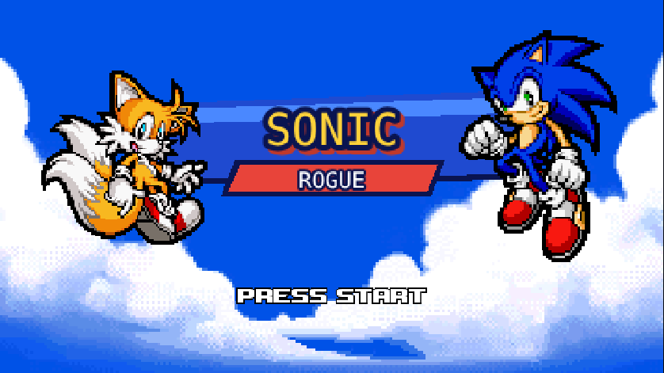
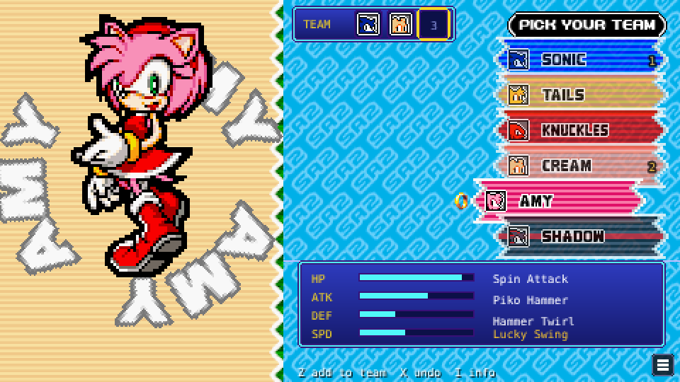
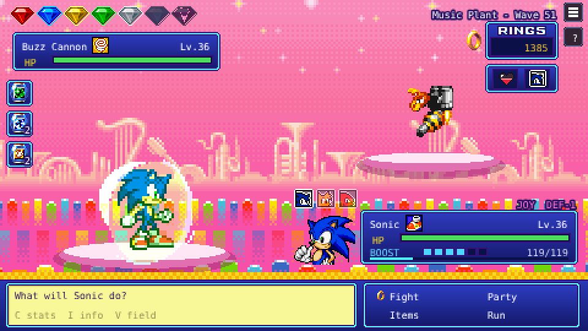
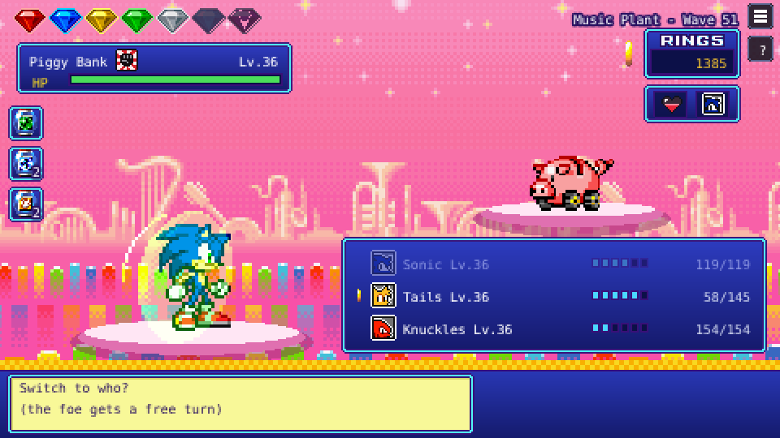

# Sonic Rogue

[](https://github.com/DuncanDoSomething/Sonic-Rogue/actions/workflows/deploy.yml)

A turn-based roguelite in the style of PokéRogue, set in the world of the Sonic Advance games.
Pick a team of three, fight your way through nine zones and see how far you get.

**[Play it in your browser](https://duncandosomething.github.io/Sonic-Rogue/)**

Non-commercial fan project. Not affiliated with SEGA or Sonic Team.

| | |
|---|---|
|  |  |
|  |  |

## Gameplay

- **Team of three.** Sonic, Tails and Amy are available from the start. Knuckles and Cream show up as rivals; beat them to unlock them, and they can join your current run.
- **Boost meter instead of PP.** Spin Attack is free and builds Boost. Stronger moves cost Boost and never miss. Every character learns an ultimate at level 30 that uses the full meter.
- **Stuns and flinches.** Some moves stop the foe from acting for a turn or more.
- **Ultimate cut-ins.** Every ultimate opens with a Persona-style cut-in and has its own animation: Sonic turns Super Sonic, Tails calls down lightning, Knuckles hits like a meteor, Amy whips up a tornado and Cream calls in the Chao.
- **Types.** Speed, Fly and Power, based on the team types from Sonic Advance 3 and Heroes. Fly beats Power, Power beats Speed, Speed beats Fly.
- **Passives and ultimates.** Every character has a passive and an ultimate with its own effect: Sonic gets faster with every KO and can make the foe miss, Tails stuns foes and punishes them for it, Knuckles is a glass cannon who can survive one KO per zone, Amy builds up to huge critical hits that cost her own HP, and Cream heals the team. Press **C** in character select to see everything a character can do.
- **Stat stages.** Some moves and passives raise ATK, DEF or SPD by a stage (+25% each, up to +6). Stages reset after every zone boss.
- **Nine zones** from Sonic Advance 2 and 3, each with its own music. Some zones affect your team, like the heat in Hot Crater or the cold in Twinkle Snow.
- **Bosses and Chaos Emeralds.** Every tenth wave is a boss. Beat it to collect a Chaos Emerald.
- **Rewards and a shop** after every wave. Prices go up every zone, and your bag only holds two items, so healing has to be planned.
- **Exp. Share** after the first boss (50%, later 80%). The character in the fight always levels fastest.
- **KOs last.** A teammate who goes down stays down until you beat the zone boss. From wave 20 the shop sells an expensive Revive.
- **Auto-save** after every wave. Use Save & Quit in the pause menu, or just close the tab, and continue later.

Press **H** (or the **?** button) in game for the full rules.

### Controls

| Key | Action |
|---|---|
| Arrow keys / WASD | Move |
| Z / Enter / Space | Confirm |
| X / Esc | Back |
| C | Your stats / move info |
| I | Character kits: passive, moves and ultimate (arrows switch teammates) |
| V | Field: zone effect, stat stages, type matchup |
| H | How to play |
| M | Pause menu: settings, how to play, save & quit |

Mouse and touch work too.

## Tech

- **Phaser 3** and **TypeScript**, bundled with **Vite**.
- **Vitest** unit tests for the battle rules: damage, stat stages, types, Boost, shop prices, zones, passives, saves and unlocks.
- **Playwright** end-to-end tests that start the real build in Chromium and play it with the keyboard: picking a team, taking turns, winning a wave, switching, KOs, saving and continuing, menus, plus regression tests for bugs found during development. The game is drawn on a canvas, so the tests check the game state instead of pixels; that keeps them stable while the UI changes.
- **GitHub Actions** runs both test suites on every push to `main`, then builds the game and deploys it to GitHub Pages. A failing test blocks the deploy, and the Playwright report (screenshots and traces) is uploaded when something breaks.
- A **balance simulation** (`npm run sim`) plays 2000 boss fights per character to check difficulty after a change.
- An **asset pipeline in Python** (Pillow, NumPy, SciPy) that cuts sprites out of ripped sprite sheets, aligns animation frames on the character's body and builds Phaser texture atlases.
- Idle fidgets, upgraded move animations (lock-on Homing Attack, flaming Spin Dash, fire-blast Knuckle Punch, spinning discs), ultimates and hit effects are built from sprite animations plus code-drawn effects (lightning, flames, shockwaves, masked cut-in bands), with a short hit-stop on every hit.
- The intro recreates the Mode 7 ocean from Sonic Advance 2 by drawing the water line by line on a canvas, with perspective and distance blending.
- Game data (characters, moves, zones, items) is kept apart from the scenes, so balance changes don't touch battle code.

## Running locally

Requires Node.js 18 or newer.

```bash
npm install
npm run dev      # dev server with hot reload at http://localhost:5173
npm test         # unit tests
npm run e2e      # end-to-end tests (builds the game first)
npm run sim      # boss balance simulation
npm run build    # production build in dist/
```

Add `?test` to the URL (locally or on the live site) for test mode: every character is unlocked, nothing is saved, and in battle the number keys give you full Boost, level 30, a skip to the zone boss and more (press **T** for the list).

## Project structure

```
src/
  data/          characters, moves, passives, zones, items, saves, settings, unlocks
  scenes/        title/intro, character select, battle, help, settings, credits
  assets/        sprite atlases, backgrounds and menu graphics
  audio.ts       music (streamed, with crossfades) and sound effects
public/audio/    music, sound effects and voices
tests/           unit tests (Vitest)
e2e/             end-to-end tests (Playwright)
tools/           Python asset pipeline and the balance simulation
```

## Roadmap

See [ROADMAP.md](ROADMAP.md).

## Credits

Sonic the Hedgehog and all related characters, sprites and music are owned by SEGA and Sonic Team.
This project uses community sprite rips from [The Spriters Resource](https://www.spriters-resource.com/):

- **Characters:** Ren "Foxx" Ramos (Sonic Advance 3), Bonzai (Super Sonic)
- **Power type icon:** based on the POW icon ripped by Taels (Sonic Battle)
- **Cut-in art and effects:** QuadFactor (Sonic Battle)
- **Badniks:** SkyLights (Sonic Advance 3), Fatazz / Turtle474 (Sonic Advance 2)
- **Backgrounds:** Παρατηρητής, Ice
- **Title, menus and intro:** raidlandguy
- **Character select:** Random Talking Bush, EternalLight
- **Objects, monitors and shields:** Spitfya, Roj, Flare, Techokami, Gussprint

Gameplay inspired by [PokéRogue](https://pokerogue.net).

Design and development by Moe, with Claude (Anthropic) as a coding assistant.
