# Sonic Rogue

[](https://github.com/DuncanDoSomething/Sonic-Rogue/actions/workflows/deploy.yml)

A turn-based roguelite in the style of PokéRogue, set in the world of the Sonic Advance games.
Pick a team of three, fight your way through nine zones and see how far you get.

**[Play it in your browser](https://duncandosomething.github.io/Sonic-Rogue/)**

Non-commercial fan project. Not affiliated with SEGA or Sonic Team.

| | |
|---|---|
|  |  |
|  |  |
| 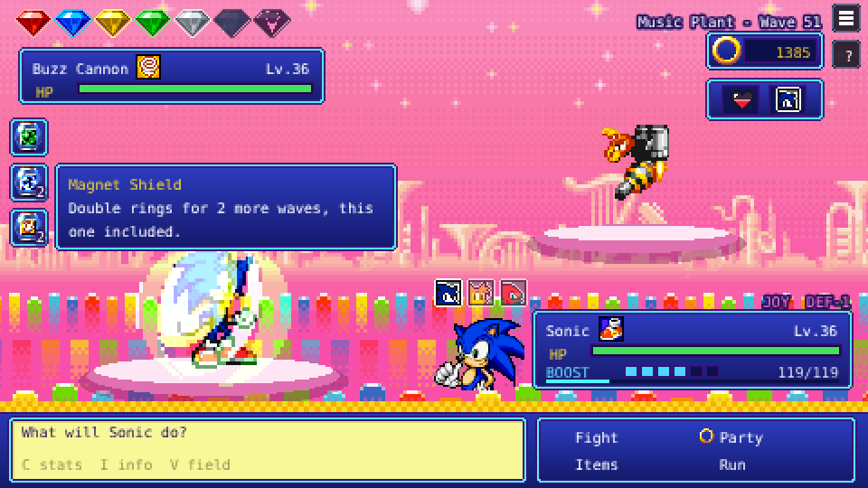 | 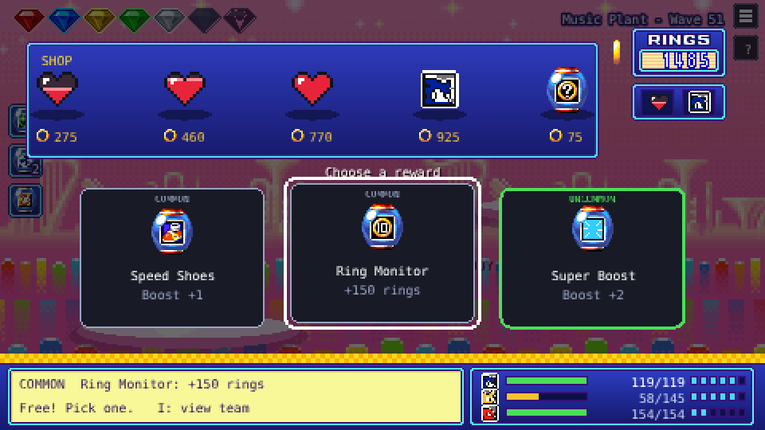 |
| 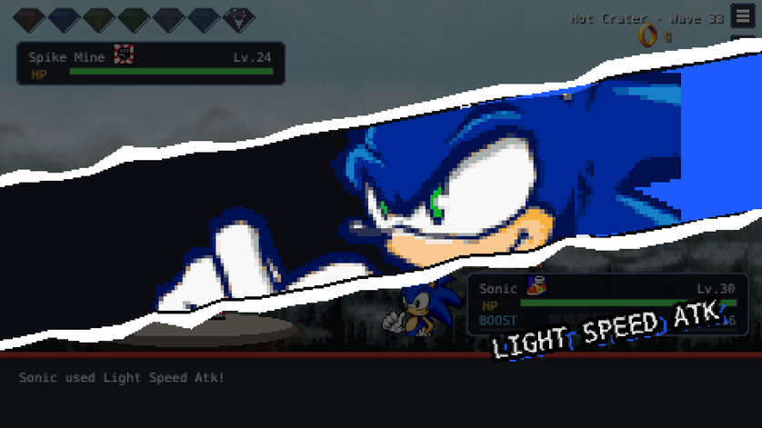 | 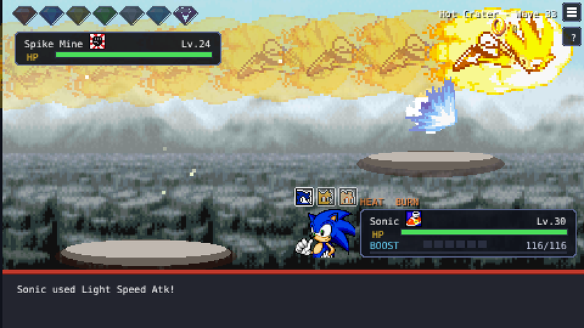 |
| 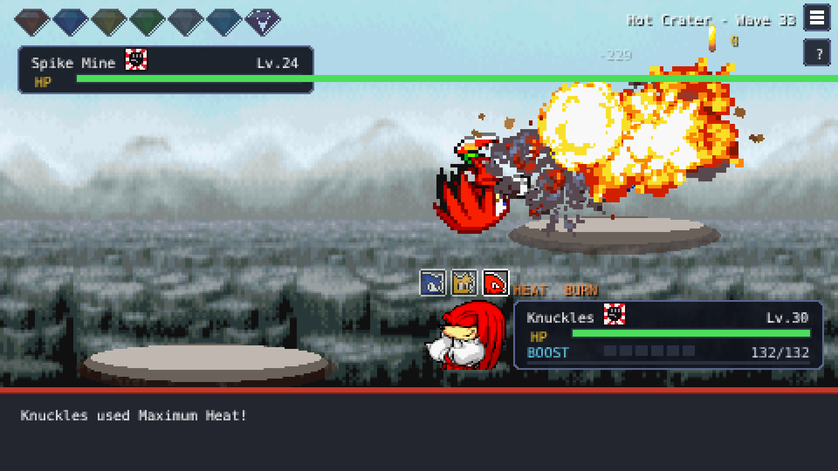 | 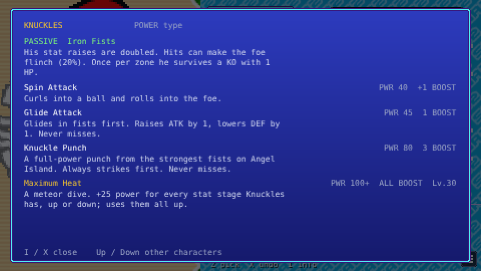 |
| 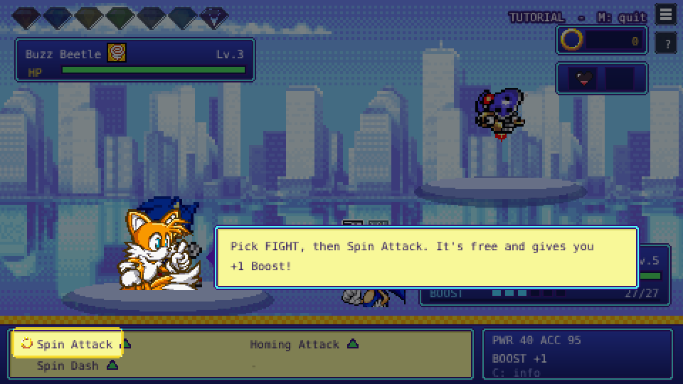 | 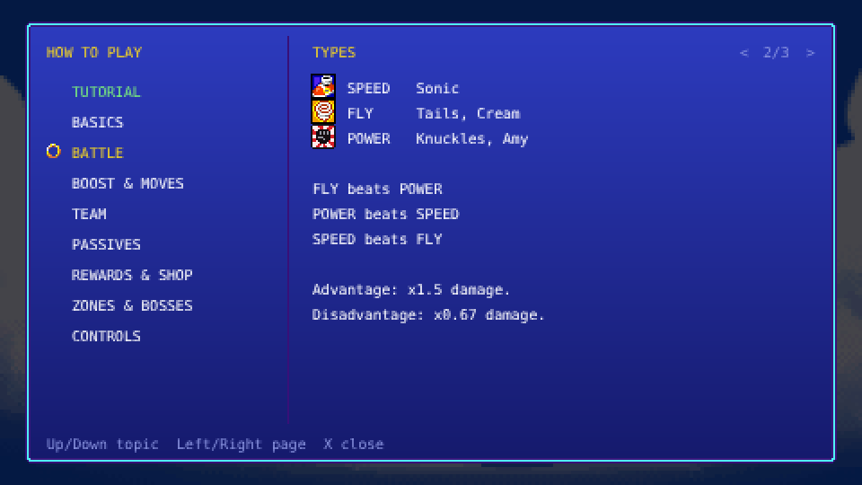 |
| 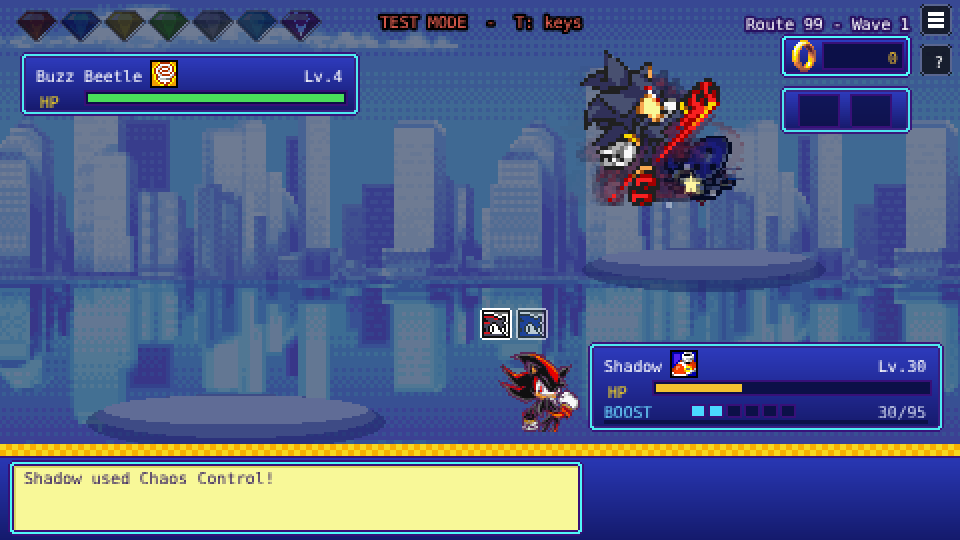 | 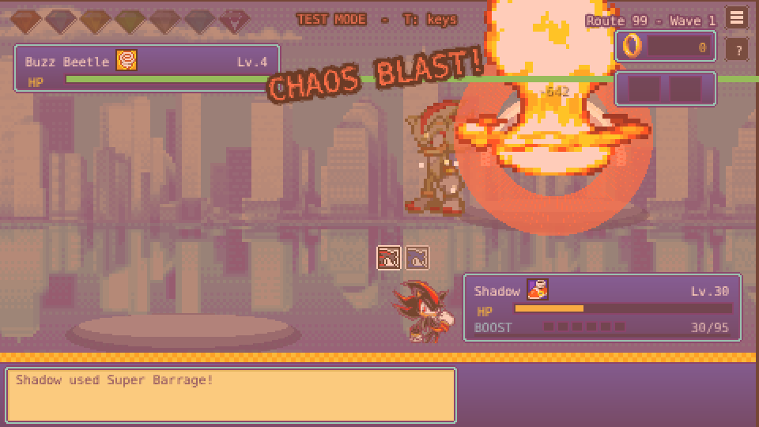 |
| 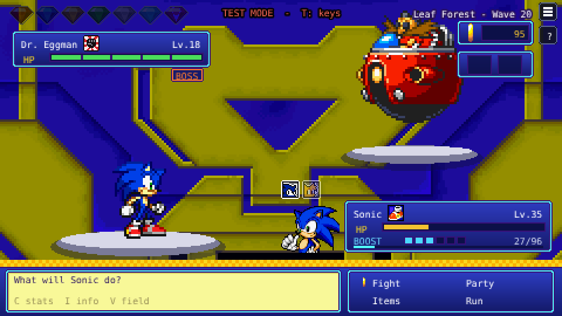 | 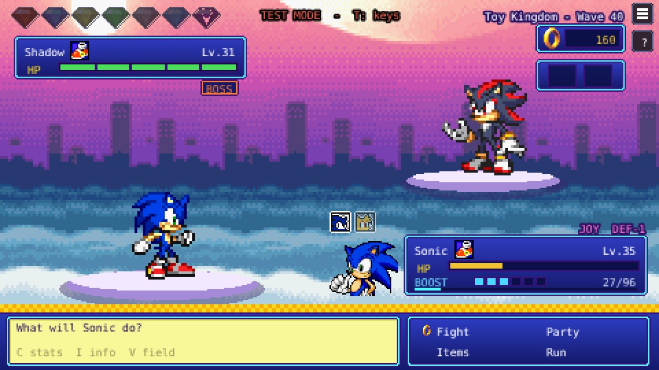 |

## Gameplay

- **Team of three.** Sonic, Tails and Amy are available from the start. Knuckles and Cream show up as rivals and Shadow as a rare boss; beat them to unlock them, and they can join your current run. Rivals have 2 shields and their own trick: Sonic attacks before you can move, Tails ambushes you, Knuckles hangs on once with Iron Will, Cream revives with Chao Blessing, Amy starts warmed up. Before and after the fight they trade a few lines with whoever you have on the field, Sonic Battle-style with portraits (turn it off with Rival Talk in Settings).
- **Boost meter instead of PP.** Spin Attack is free and builds Boost. Stronger moves cost Boost and never miss. Every character learns an ultimate at level 30 that uses the full meter.
- **Stuns and flinches.** Some moves stop the foe from acting for a turn or more.
- **Ultimate cut-ins.** Every ultimate opens with a Persona-style cut-in and has its own animation: Sonic turns Super Sonic, Tails calls down lightning, Knuckles hits like a meteor, Amy whips up a tornado, Cream calls in the Chao and Shadow goes Super Shadow for a Chaos Blast.
- **Types.** Speed, Fly and Power, based on the team types from Sonic Advance 3 and Heroes. Fly beats Power, Power beats Speed, Speed beats Fly.
- **Passives and ultimates.** Every character has a passive and an ultimate with its own effect: Sonic gets faster with every KO and can make the foe miss, Tails stuns foes and punishes them for it, Knuckles takes hits to raise his ATK and always hits back (Guard blocks a hit and counters hard), Amy builds up to guaranteed and double critical hits, Cream heals the team, and Shadow snowballs: every KO makes Chaos Control free again and raises his ATK and SPD. Press **I** in battle or character select to see everything a character can do.
- **Badniks that play differently.** Buzz Beetles shrug off the first hit, Copter Octo charges up a double hit (watch for the **!**), Spike Mines hurt to touch, Piggy Banks harden every turn but drop double rings, Buzz Cannons poison, Snow Bots freeze, Shark Jets steal Boost. Elites get a random trait on top: Armored, Enraged, Regenerating or Swift. Hover the label under a foe's HP bar to see what it does.
- **Stat stages.** Some moves and passives raise ATK, DEF or SPD by a stage (+25% each, up to +6). Stages reset after every zone boss.
- **Nine zones** from Sonic Advance 2 and 3, each with its own music. Every run starts in Route 99 and Leaf Forest; after that the zones are shuffled within groups (Sunset Hill with Music Plant and Toy Kingdom back to back, then the snow zones, then Hot Crater and Sky Canyon), so every run feels different but the hardest zones stay at the end. Some zones affect your team, like the heat in Hot Crater or the cold in Twinkle Snow.
- **Bosses and Chaos Emeralds.** Every tenth wave is a boss. Beat it to collect a Chaos Emerald. After a zone boss everyone gets back up to at least 50% HP; after waves 20, 40, 60 and 80 the whole team is fully healed with at least 3 Boost.
- **Sonic-style battle HUD** based on the Tiny Chao Garden UI: a ring counter, your bag and active buffs always on screen (hover for details), and every teammate's HP and Boost in the party menu and during rewards.
- **Rewards and a shop** after every wave. Rewards come in five rarities, from Speed Shoes and Shields to Chaos Drives, Eggman's trapped monitors and the ultra rare Move Chip. Healing mostly costs rings, your bag only holds two items, and income and prices follow one money curve, like PokéRogue. Design notes: [docs/design/rewards.md](docs/design/rewards.md).
- **Exp. Share** after wave 10 (50%, then 80% after wave 20). The character in the fight always levels fastest.
- **KOs last.** A teammate who goes down stays down until you beat the zone boss. From wave 20 the shop sells an expensive Revive.
- **Auto-save** after every wave. Use Save & Quit in the pause menu, or just close the tab, and continue later.
- **Learn as you go.** How to Play (on the title screen, or **H** / **?** in game) is split into topics. From the title screen you can also start a short practice fight where Tails walks you through attacking, Boost, items, switching and rewards. During your first runs Tails pops up with a tip the first time something new happens (a zone effect, a rival, a boss, a KO); turn the tips off in Settings.

### Controls

| Key | Action |
|---|---|
| Arrow keys / WASD | Move |
| Z / Enter / Space | Confirm |
| X / Esc | Back |
| C | Your stats / move info |
| I | Character kits: passive, moves and ultimate (arrows switch teammates), also while picking a reward |
| V | Field: zone effect, stat stages, type matchup |
| H | How to play |
| M | Pause menu: settings, how to play, save & quit |

Mouse and touch work too.

## Tech

- **Phaser 3** and **TypeScript**, bundled with **Vite**.
- **Vitest** unit tests for the battle rules: damage, stat stages, types, Boost, shop prices, zones, passives, saves and unlocks.
- **Playwright** end-to-end tests that start the real build in Chromium and play it with the keyboard: picking a team, taking turns, winning a wave, switching, KOs, saving and continuing, menus, plus regression tests for bugs found during development. The game is drawn on a canvas, so the tests check the game state instead of pixels; that keeps them stable while the UI changes.
- **GitHub Actions** runs both test suites on every push to `main`, then builds the game and deploys it to GitHub Pages. A failing test blocks the deploy, and the Playwright report (screenshots and traces) is uploaded when something breaks.
- A **balance simulation** (`npm run sim`) plays whole runs without graphics, with the same rules as the game: every team of 3, a few hundred runs each, and writes the results to `sim/results.json`. `npm run sim -- --exp gloveOnce` tries a balance change first (see `sim/run.ts`).
- An **asset pipeline in Python** (Pillow, NumPy, SciPy) that cuts sprites out of ripped sprite sheets, aligns animation frames on the character's body and builds Phaser texture atlases. Idles that need pixel-perfect alignment are rebuilt from upscaled reference GIFs by sampling the pixel grid back to sprite resolution.
- Layered idles like the Advance games (stand, get impatient, then sit or nap), run-ups, anticipation, knockback and landing dust on attacks, upgraded move animations (lock-on Homing Attack, Sonic's Light Speed Combo, fire-blast Knuckle Punch, spinning discs), ultimates and hit effects are built from sprite animations plus code-drawn effects (lightning, flames, shockwaves, masked cut-in bands), with a short hit-stop on every hit.
- The intro recreates the Mode 7 ocean from Sonic Advance 2 by drawing the water line by line on a canvas, with perspective and distance blending.
- Game data (characters, moves, zones, items) is kept apart from the scenes, so balance changes don't touch battle code.

## Running locally

Requires Node.js 18 or newer.

```bash
npm install
npm run dev      # dev server with hot reload at http://localhost:5173
npm test         # unit tests
npm run e2e      # end-to-end tests (builds the game first)
npm run sim      # balance simulation (whole runs, every team)
npm run build    # production build in dist/
```

Add `?test` to the URL (locally or on the live site) for test mode: every character is unlocked, nothing is saved, and in battle the number keys give you full Boost, +10 levels, a skip to the zone boss, the next zone and more (press **T** for the list).

## Project structure

```
src/
  data/          characters, moves, passives, zones, items, saves, settings, unlocks
  scenes/        title/intro, character select, battle, help, settings, credits
  assets/        sprite atlases, backgrounds and menu graphics
  audio.ts       music (streamed, with crossfades) and sound effects
public/audio/    music, sound effects and voices
tests/           unit tests (Vitest)
e2e/             end-to-end tests (Playwright)
tools/           Python asset pipeline and the balance simulation
```

## Roadmap

See [ROADMAP.md](ROADMAP.md).

## Credits

Sonic the Hedgehog and all related characters, sprites and music are owned by SEGA and Sonic Team.
This project uses community sprite rips from [The Spriters Resource](https://www.spriters-resource.com/):

- **Characters:** Ren "Foxx" Ramos (Sonic Advance 3, Cheese and the Chao), Bonzai (Super Sonic), QuadFactor (Shadow and the team's big moves, Sonic Battle), Shadow Mastah (Super Shadow, Pixeltendo Sonic Battle Project)
- **Portraits:** Bacon (Sonic Battle story portraits)
- **Eggman:** SkyLights (rip), Dinoshi 64 (organization), QuadFactor (palette)
- **X-Zone and XX backgrounds:** Παρατηρητής
- **Power type icon:** based on the POW icon ripped by Taels (Sonic Battle)
- **Cut-in art and effects:** QuadFactor (Sonic Battle)
- **Badniks:** SkyLights (Sonic Advance 3), Fatazz / Turtle474 (Sonic Advance 2), Spitfya and Techokami (Sonic Advance)
- **Super Egg Robo Z (final boss):** SkyLights (Sonic Advance 3)
- **Ending art (run win):** EternalLight (Sonic Advance 3)
- **Backgrounds:** Παρατηρητής, Ice
- **Title, menus and intro:** raidlandguy
- **Character select:** Random Talking Bush, EternalLight
- **Objects, monitors and shields:** Spitfya, Roj, Flare, Techokami, Gussprint
- **Sound effects:** Mr Lange ("Sonic Sounds Complete", Sonic Advance 3 rips); the names of the numbered sounds come from the [SAT-R Sonic Advance 3 decompilation](https://github.com/SAT-R/sa3) (`tools/build_sa3_sfx.py`)

Gameplay inspired by [PokéRogue](https://pokerogue.net).

Design and development by Duncan, with Claude (Anthropic) as a coding assistant.
